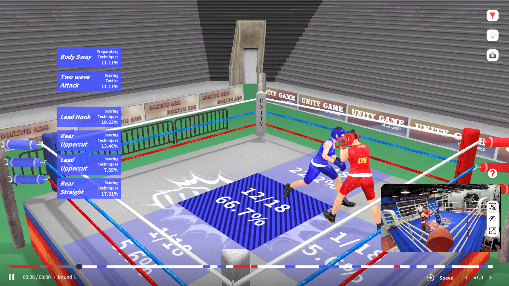
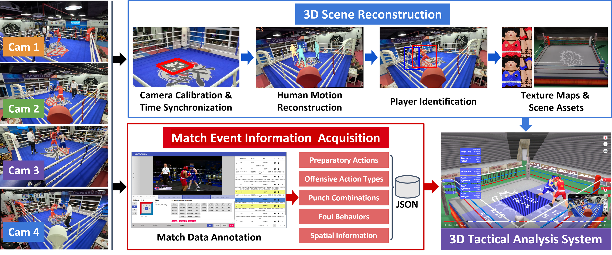
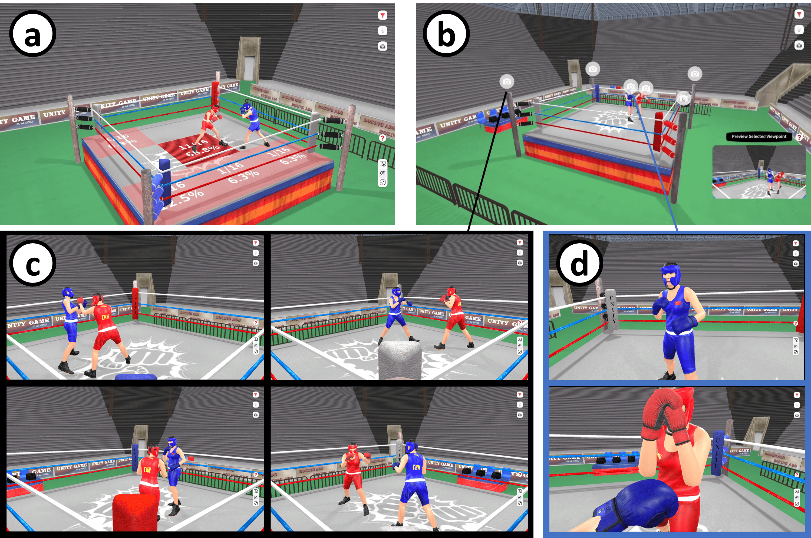
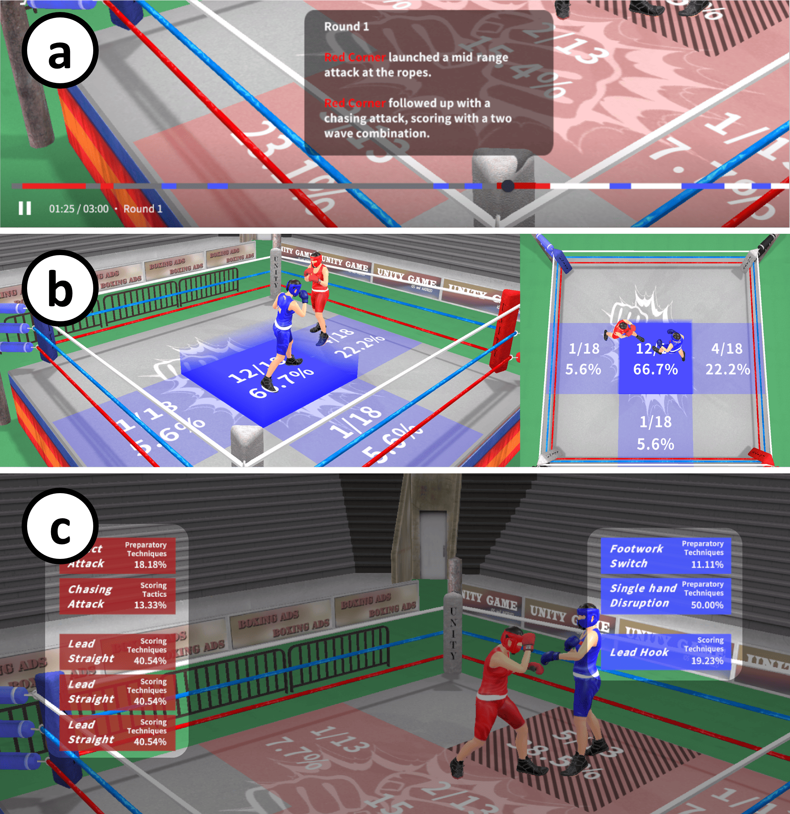
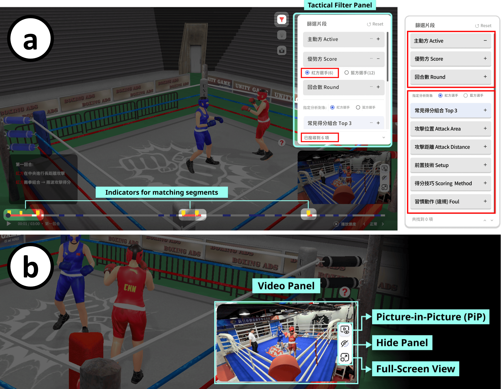

# In Sight of Insights

**In Sight of Insights: Virtual Representation of Boxing for Interactive Viewpoint in Tactical Analysis through 3D Human Motion Reconstruction (TVCG 2026)**

This repository accompanies the paper source and public dataset for **In Sight of Insights**, a desktop immersive analytics system for boxing tactical analysis. The project explores how reconstructed 3D match scenes, free-viewpoint interaction, and embedded tactical annotations can help coaches and athletes review combat-sport matches beyond the limits of fixed-camera video.



## Teaser Video

[](https://github.com/penguin210135/In-Sight-of-Insights/blob/main/Teaser%20Video.mp4)

Click the image above (or [this link](https://github.com/penguin210135/In-Sight-of-Insights/blob/main/Teaser%20Video.mp4)) to watch a short teaser video summarizing the motivation, system, and results of **In Sight of Insights**.

## Paper Core Insight

Boxing scouting is still largely driven by repeated video replay, manual event annotation, and separately prepared statistical charts. This workflow makes it difficult to understand tactical details that depend on spatial relationships, such as distance control, athlete posture, ring position, offensive initiative, and interactions hidden by occlusion.

**In Sight of Insights** addresses this gap by reconstructing boxing matches as navigable 3D scenes and embedding tactical event data directly into that reconstructed space. Instead of forcing analysts to mentally connect fixed-view video clips with separate charts, the system lets them inspect the same match from adjustable viewpoints while preserving links to the original video evidence and expert annotations.

## Core Contributions

- **Formative understanding of boxing scouting:** interviews and document analysis with professional boxing coaches characterize current pre-fight preparation workflows and their limitations.
- **Integrated 3D tactical analysis system:** a desktop workflow combines sparse multi-view motion capture, SMPL-based athlete reconstruction, Unity replay, free-viewpoint camera control, event visualization, tactical filtering, synchronized video, and timeline navigation.
- **Embedded combat-sport visualization design:** tactical labels, scoring timelines, attack distribution heatmaps, and filter panels are placed in the same analysis context as reconstructed athlete motion.
- **Preliminary empirical evaluation:** two studies compare viewpoint modes and evaluate the system against a video-based workflow with the same annotated match data, showing improved tactical observation accuracy and comparable analytical efficiency in the reported study setting.

## System Overview



The system uses two main information streams:

1. **Reconstructed athlete motion:** boxing matches are recorded using synchronized multi-view cameras around the ring. The pipeline estimates 3D poses, filters active athletes, fits SMPL body motion, and retargets the result to virtual avatars.
2. **Expert tactical annotations:** professional scouting annotations and match event records are synchronized with the motion data. These annotations describe offensive actions, punch combinations, fouls, spatial regions, scoring context, and related tactical information.

The resulting replay can be inspected through fixed ring-corner views, first-person style views, or free-viewpoint camera control.



## Interface Features

The paper describes several analysis features built around the reconstructed match scene:

- **Free-viewpoint replay:** analysts can move the camera to inspect occluded exchanges, punch contact, distance, posture, and ring control from perspectives unavailable in the original footage.
- **Scoring highlight timeline:** color-coded event segments support rapid navigation to offensive sequences and scoring moments.
- **Attack distribution heatmap:** a 3 x 3 ring grid summarizes where offensive events occur and how often they appear.
- **Action sequence labels:** labels near each athlete summarize techniques, combinations, scoring tactics, and habitual actions.
- **Tactical filter panel:** analysts can filter by contextual factors such as round, scoring side, distance, action type, and combinations.
- **Synchronized video panel:** original footage can be shown alongside the 3D replay for evidence checking and continuity with existing video-based scouting.





## Data Layout

The `data/` directory is organized by match id:

```text
data/
  03153001/
    03153001_data.json
    03153001_pose.json
  03153101/
    ...
```

Each match folder may include:

| File | Description |
| --- | --- |
| `<match_id>_data.json` | Event annotation data matched from the original root-level `*_data.json` file by the `contest` field. It contains match metadata, event segments, labels, frame timing, scoring/tactical categories, and athlete/team information when available. |
| `<match_id>_pose.json` | Smoothed SMPL pose sequence used for reconstructed athlete motion and replay. |


## Citation

This work has been published in **IEEE Transactions on Visualization and Computer Graphics (TVCG)**. Please cite the paper when using the dataset, figures, or code.

```bibtex
@ARTICLE{11755489,
  author={Tsai, Tsung-Hsun and Han, Ping-Hsuan and Wang, Kai-Ting and Chen, Sheng-Ho and Hu, Min-Chun and Chiu, Wen-Hsin and Chu, Hung-Kuo},
  journal={IEEE Transactions on Visualization and Computer Graphics},
  title={In Sight of Insights: Virtual Representation of Boxing for Interactive Viewpoint in Tactical Analysis through 3D Human Motion Reconstruction},
  year={2026},
  volume={},
  number={},
  pages={1-11},
  keywords={Visualization;Videos;Sports;Labeling;Cameras;Computers;Conferences;Annotations;Punching;Broadcasting;Boxing analysis;immersive visualization;tactical observation;human mesh reconstruction;sports analysis},
  doi={10.1109/TVCG.2026.3747525}}
```
